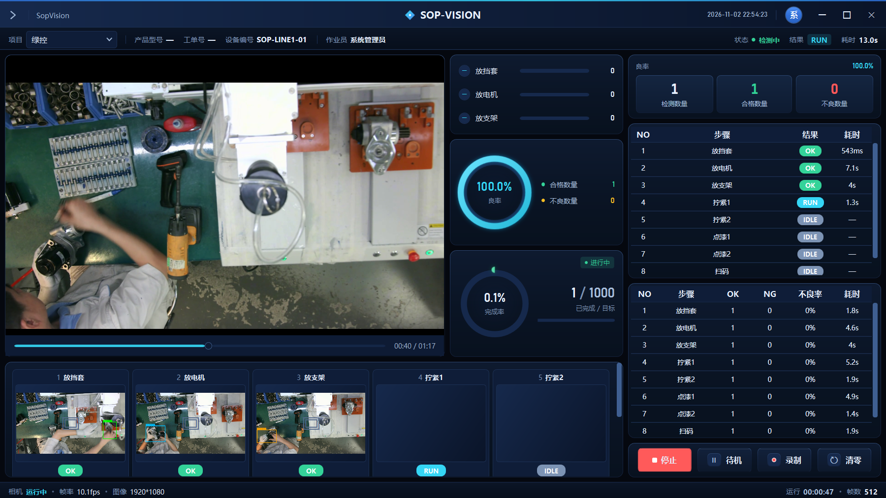
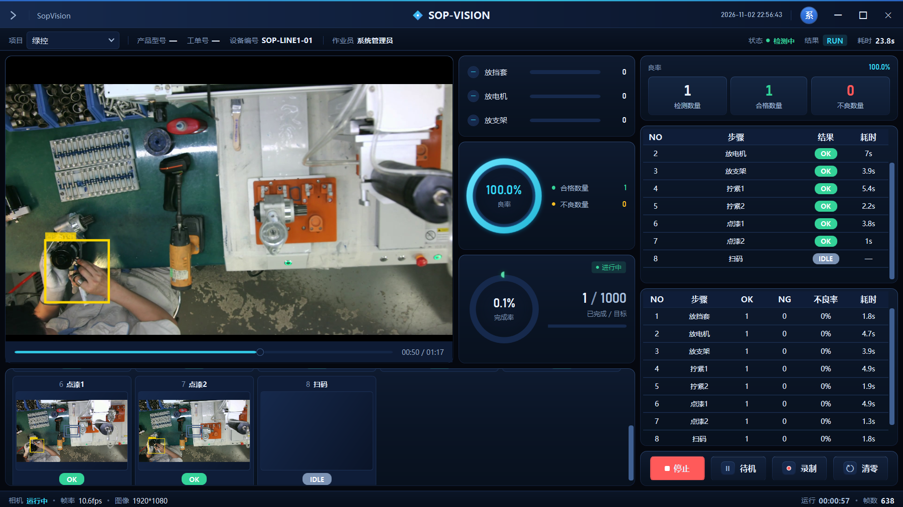
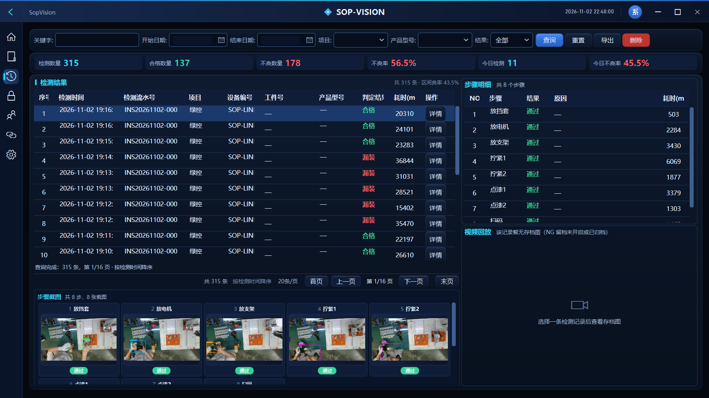
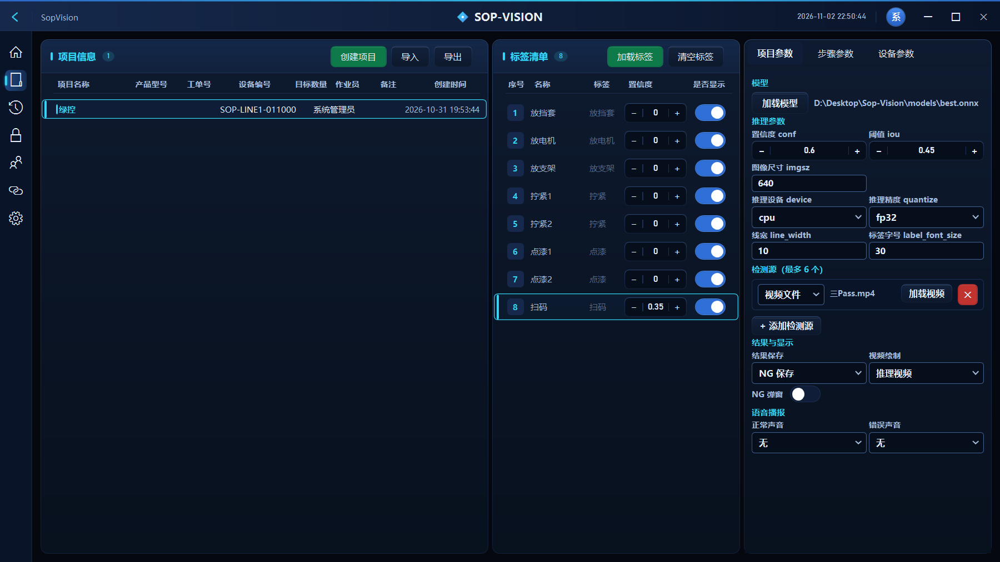
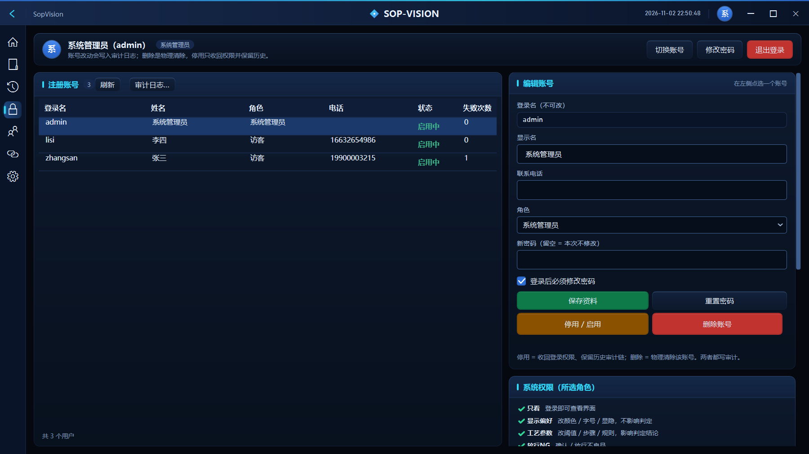
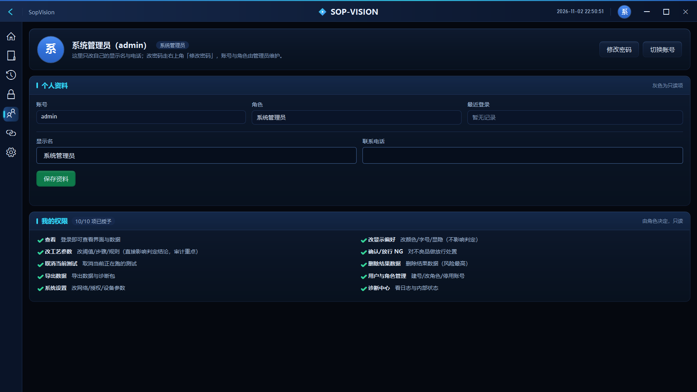
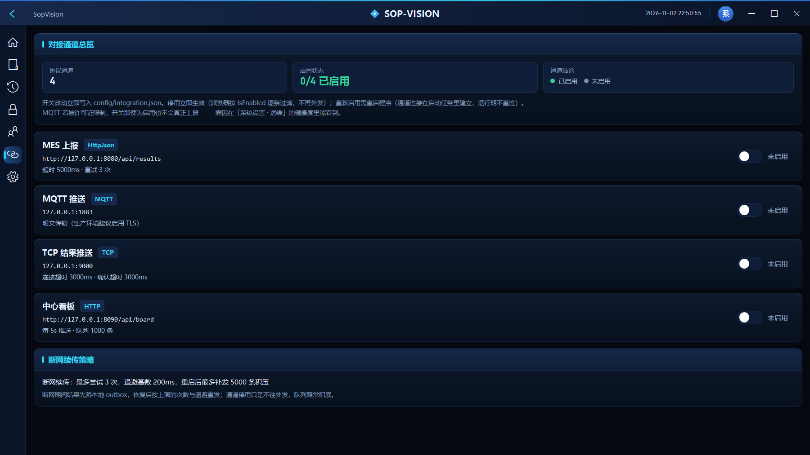
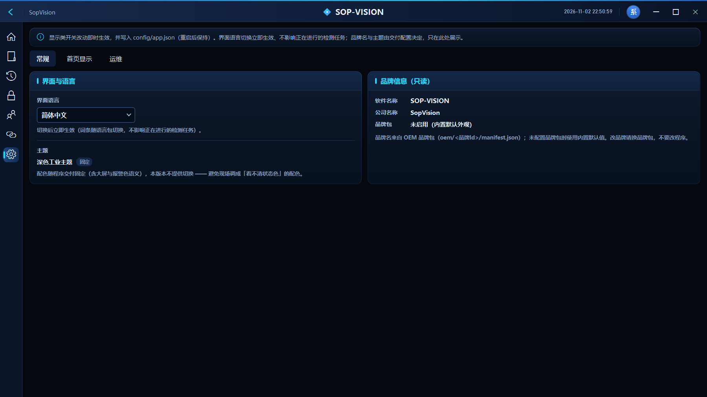
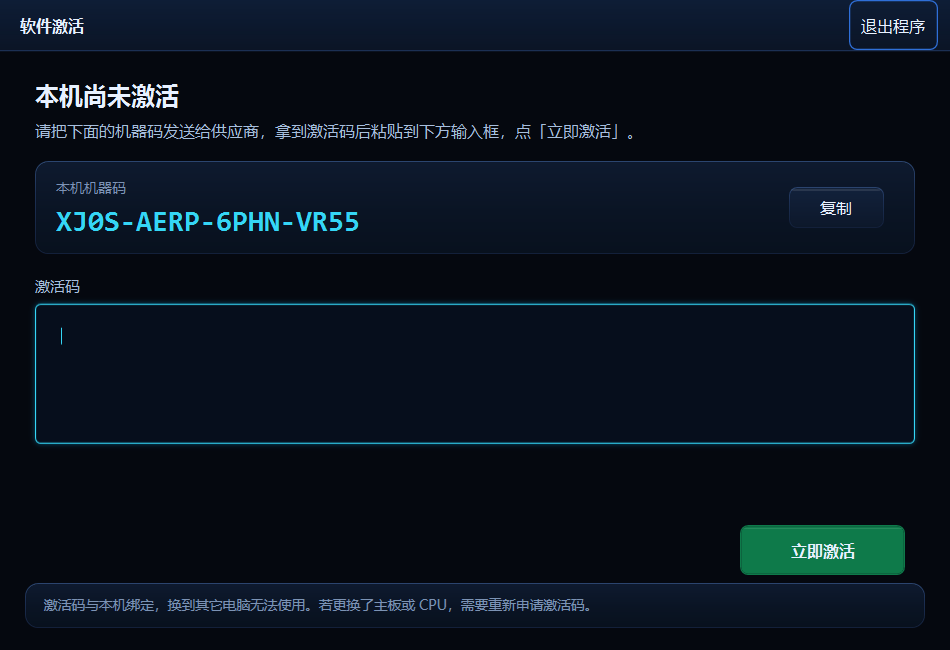

# SOP-VISION · 行为分析视觉检测系统

**面向装配工位的实时 SOP 合规检测。** 一台相机、一块屏，把「这一步做了没有、做得对不对、顺序有没有错」变成每件产品都能追溯的判定结果。

Windows x64 · .NET 8 · YOLO / ONNX Runtime · 8 工步顺序判定 · 全链路留档



---

## 这是什么

产线上最贵的问题不是「机器坏了」，而是**漏装了一件，三天后客户才发现**。

SOP-VISION 站在工位旁边看人干活：相机持续取流，模型识别动作与零件，把一次装配拆成 8 个工步逐件判定——放挡套、放电机、放支架、拧索、点漆、扫码。每一步有明确的 OK / NG 结论和耗时，顺序错了会被识别成跳步，缺件会当场判 NG，不良品立刻在屏幕上标出来，同时落库、留图、留视频。

它不是一个「检测模型 Demo」，而是一套能上产线的软件：启动自检、看门狗、审计日志、断网续传、机器码授权——这些不性感的部分才是现场能不能跑三个月的原因。

---

## 界面

**实时工作台** —— 左画面、右判定、下步骤条，一眼看清这一件走到哪一步。



画面上的黄色框是模型当前锁定的目标；右侧步骤表实时刷新 OK / NG，底部每个格子是**这一步的现场截图**，异常时可回看「当时到底长什么样」。

**历史记录** —— 每一次检测都可查、可导、可回放。



筛选、翻页、看步骤截图、播放 NG 留档视频，全部在一个页面完成。检测数量 / 合格 / 不良 / 不良率四块指标实时统计。

**项目管理** —— 产品、工步、模型、检测源在一页配置。



工步顺序、判定阈值、模型路径、推理设备、视频源、留档策略都在这里改，改完即生效。

**账号与权限** —— 10 个能力位，谁能改工艺、谁能删数据说得清。





**MES / 系统对接** —— 四种协议独立开关，断网不丢数据。



HTTP / MQTT / TCP / 中心看板四路并行，失败自动退避重试，恢复后从 outbox 补发，队列有上限、超出有告警。

**系统设置** —— 中英双语、主题、运维自检。



**首次运行** —— 机器码绑定，一机一码。



---

## 能力清单

| 能力                   | 说明                                                                      |
| ---------------------- | ------------------------------------------------------------------------- |
| **8 工步顺序判定**     | 逐件判定 OK / NG，跳步、漏装、顺序错都能识别；每步独立耗时统计            |
| **多相机接入**         | USB / 千兆网口 / 视频文件 / 图片序列 / 屏幕采集，按角色绑定，掉线单独告警 |
| **GPU / CPU 双路推理** | 有 CUDA 自动走 GPU（30+ fps），没有自动回退 CPU（8~12 fps），不需要改配置 |
| **步骤截图留档**       | 每步一张现场图，NG 按策略留视频（前 3s / 后 1s），历史页可直接回放        |
| **四路外部对接**       | MES(HTTP) / MQTT / TCP / 中心看板，独立开关，断网续传                     |
| **账号 / 角色 / 权限** | 10 个能力位，工艺、数据、设置分权；所有敏感操作进审计日志                 |
| **组态看板设计器**     | 拖拽搭车间大屏，绑定实时指标                                              |
| **启动自检 + 看门狗**  | 15 项启动任务，采集/判定/UI 三条看门狗，卡死自动停线而不是留下假数据      |
| **诊断包导出**         | 一键打包日志、配置、环境信息（已脱敏），远程排障不用跑现场                |
| **机器码授权**         | RSA-PSS 签名激活码，一机一码，换主板需重新申请                            |

---

## 下载与运行

### 1. 下载

**[⬇ SopVision-v1.0.0-cpu-win-x64.zip](SopVision-v1.0.0-cpu-win-x64.zip)** · 82.8 MB

> 这是 **CPU 评估版**：去掉了 960 MB 的 CUDA / cuDNN 运行库，任何一台 Windows 都能跑，代价是推理速度约为 GPU 版的 1/3。产线版请联系作者获取。

### 2. 安装运行时（必须）

本包是框架依赖版，需要 **.NET 8 桌面运行时**：

<https://dotnet.microsoft.com/download/dotnet/8.0> → 选 **.NET Desktop Runtime 8.0.x → Windows x64**

没装的话双击会弹 `You must install or update .NET to run this application`。

### 3. 启动

解压后**双击根目录的 `启动 SopVision.bat`**（不要单独把 exe 拷出来，程序依赖同级的 config / models 目录）。

```
SopVision-v1.0.0-cpu-win-x64\
├─ 启动 SopVision.bat
├─ 使用说明.txt
├─ app\1.0.0\          ← 程序本体 + models\best.onnx
└─ config\locales\     ← 中英文语言包
```

### 4. 激活

首次启动先弹激活窗口，窗口里那串 16 位机器码就是本机指纹：

**把机器码发给作者 → 换回一段激活码 → 粘贴 → 立即激活**，之后正常登录使用。

默认操作员 `admin`（root 权限），首次登录后请立刻改密码。

### 5. 没有相机也想看效果

首页右下「开始」在没有相机时不会有画面。想直接看判定过程：

`项目管理` → `项目参数` → **检测源** 选「视频文件」→ 选一段车间视频 → 回首页点「开始」，就会走完整的 8 步判定流程。

---

## 系统要求

| 项目   | 最低                   | 推荐                            |
| ------ | ---------------------- | ------------------------------- |
| 系统   | Windows 10 x64         | Windows 11 / Server 2022        |
| 运行时 | .NET 8 Desktop Runtime | 同                              |
| CPU    | 4 核                   | 8 核以上                        |
| 内存   | 8 GB                   | 16 GB                           |
| 显卡   | 不需要（CPU 推理）     | NVIDIA + CUDA 13.2 + cuDNN 9.24 |
| 分辨率 | 1366 × 768             | 1920 × 1080                     |
| 相机   | 任意 USB 相机          | 千兆网口工业相机                |

---

## 常见问题

**Q：提示缺少 `VCRUNTIME140.dll`？**
装 [VC++ 2015-2022 x64 运行库](https://aka.ms/vs/17/release/vc_redist.x64.exe)。

**Q：推理只有 8~12 fps？**
这是 CPU 版的正常水平。GPU 版（CUDA 13.2 + cuDNN 9.24）可以到 30+ fps，且不占 CPU。

**Q：界面文字全变成 `!key!`？**
`config\locales` 被删了。重新解压整个包，不要只拷 exe。

**Q：换台电脑能用吗？**
不能。激活码与机器码绑定，换主板或 CPU 需要重新申请。

**Q：能接我们现有的 MES 吗？**
能。HTTP / MQTT / TCP 三种推送都实现了，报文格式在 `MES 对接` 页可以看到，也能改成你们的字段。

---

## 关于这个仓库

本仓库**只提供可执行程序**用于试用与评估，**不含源码**。

如果需要：

- 商用授权 / 按工位授权
- OEM 换牌（品牌名、Logo、配色随包定制）
- 私有化部署、与既有 MES / WMS 深度对接
- 定制工步判定规则、新增模型类别

请通过下方邮箱联系。

---

## 联系

- 邮箱：1405164278@qq.com

> 试用请附上激活窗口里的机器码，我会回一段可直接粘贴的激活码。
